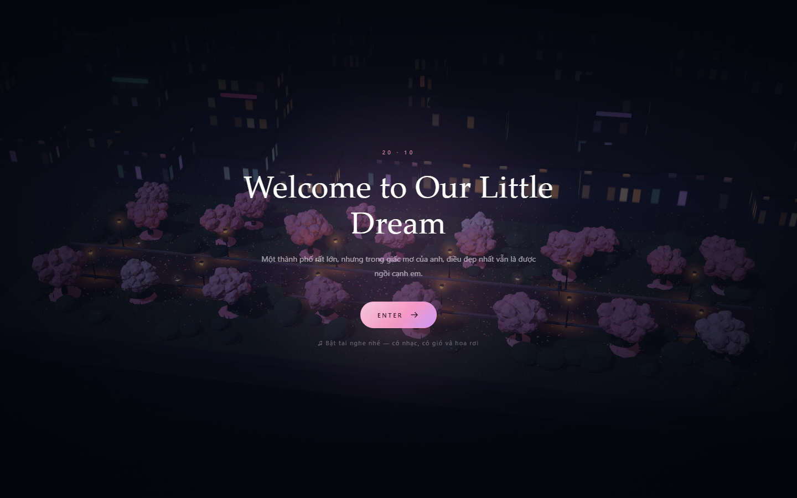
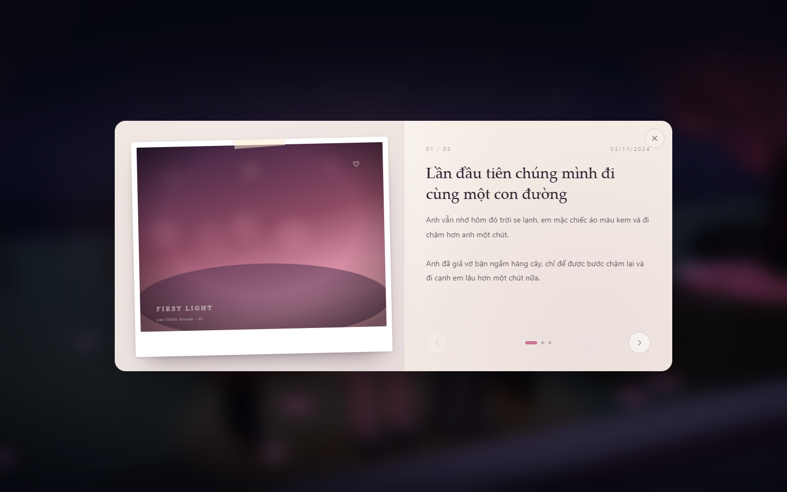
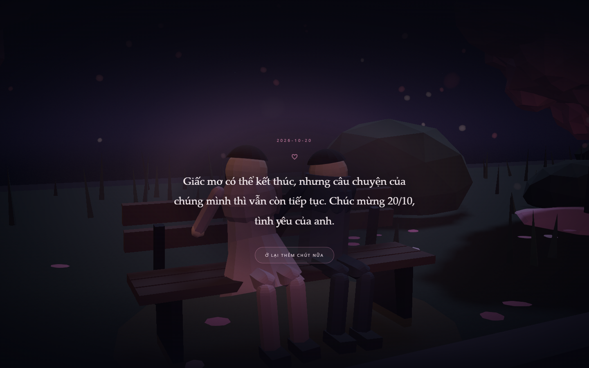
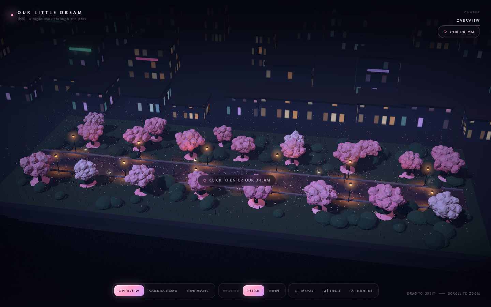
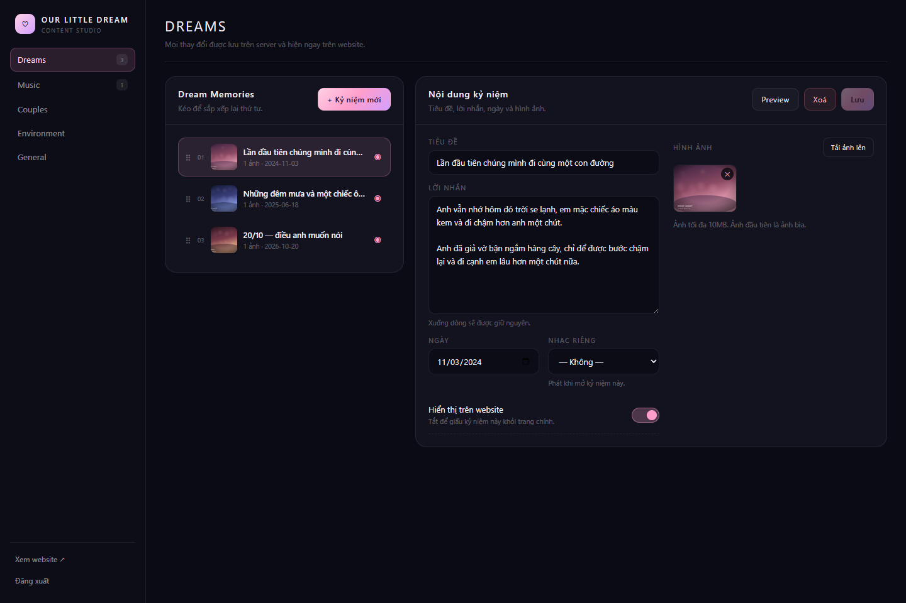

# Our Little Dream · Mini Sakura City

An interactive 3D keepsake: a tiny Japanese park at night where couples stroll under the cherry
trees, two people sleep on a bench, and a click opens a scrapbook of memories — ending with
*“Wake up together”*.

Built with **Vite + React + Three.js + React Three Fiber + Drei + postprocessing**, with a
small **server API** that stores everything in **Cloudflare D1 + R2** (a local JSON store is used
during development).



| Dream Memories | Wake up together |
| --- | --- |
|  |  |

| The park | Admin studio |
| --- | --- |
|  |  |

---

## Quick start

```bash
npm install
npm run dev        # http://localhost:5173  ·  admin: http://localhost:5173/admin
```

The dev server also runs the API (`/api/*`) with a file-backed store in `.data/`.
On first run it seeds three sample memories (replace them in the admin).

**Admin password (development):** `sakura`
Set `ADMIN_PASSWORD` in the environment (or `.dev.vars`) to change it. It is only ever checked
on the server.

```bash
npm run build      # static build into dist/
npm run preview    # preview the build (API included)
```

---

## The experience

1. **Welcome** — “Welcome to Our Little Dream”, with an Enter button that also unlocks audio.
2. **Intro fly-through** — the camera descends into the park, then settles into the default view.
3. **Explore** — NPC couples stroll the sakura road; the camera can orbit, zoom and switch modes.
4. **The couple** — two characters sleep on a bench under a warm lamp, heads resting together.
   Hovering highlights them and shows *“Click to enter our dream”*.
5. **Dream Memories** — the camera pushes in, the world blurs, and a scrapbook opens with photos,
   a title, a letter, dates, optional music, arrows, dots and a close button.
6. **Wake up together** — on the last page the Next arrow becomes this button. The scrapbook fades,
   the camera settles on the couple, they open their eyes and turn to each other, and the final
   letter appears over the falling petals.

Keyboard: `1/2/3` cameras · `W` weather · `M` music · `Q` quality · `H` hide UI · `←/→/Esc` in the scrapbook.

### Music

Two independent channels share **one** audio player, so songs never overlap:

* **City** — plays while exploring; its own playlist and volume.
* **Dream** — plays while reading. Opening the scrapbook fades the city song out (remembering its
  exact position) and fades the dream song in; closing it fades back and resumes the city track
  where it left off. A song can belong to either playlist or both.

The ♪ button in the top-right corner of the scrapbook opens a compact panel with play/pause,
previous/next, volume, loop, the dream playlist and a *“Tắt nhạc khi đọc thư”* switch. It is laid
out as a third column on desktop and as a block below the letter on mobile, so it never covers the
photos or the text. Volume, loop and the mute preference are remembered in the browser; the
defaults come from **/admin → Dream Music**.

---

## Admin (`/admin`)

| Section | What you can change |
| --- | --- |
| **Dreams** | Create / edit / delete memories, upload photos (multiple per memory), title, letter, date, per-memory music, visibility, drag & drop ordering, live preview |
| **Music** | Upload MP3/M4A/OGG/WAV, rename, set the default track, choose which playlist a song belongs to (City / Dream / both), delete, preview |
| **Dream Music** | Autoplay when the letter opens, default dream track, default volume, dedicated dream playlist (upload or pull in an existing song) |
| **Couples** | Number of NPC couples (0–5), walking speed, behaviour (wander / stroll / lingering), on/off |
| **Environment** | Petal density, light intensity, rain, fog, bloom |
| **General** | Site title, welcome copy, intro line, hover hint, wake label, final letter, special date, default camera, default music + volume |

Every change is written to the server and reflected on the site after a reload (settings that the
scene reads live update immediately).

---

## Architecture

```
src/                     React app
  components/three/      scene: road, grove, couples, special couple, city, FX
  ui/                    welcome, dream journal, music panel, letter, HUD
  admin/                 /admin dashboard
  store/useStore.js      content + flow stage + music state (zustand)
  audio/player.js        playlist player (audio element + generated ambience fallback)
server/
  api.js                 all /api routes (shared by Workers and the dev server)
  repo/d1.js             Cloudflare D1 repository
  repo/file.js           local JSON repository (same interface)
  storage/r2.js          Cloudflare R2 storage
  storage/fs.js          local disk storage
  util.js                sessions, HMAC cookies, validation helpers
functions/api/[[path]].js  Cloudflare Pages Function entry point
vite-plugin-api.js       runs the same API inside `vite dev` / `vite preview`
shared/defaults.js       default settings + seed memories
schema.sql               D1 schema
```

### API

| Method | Route | Auth |
| --- | --- | --- |
| `GET` | `/api/content` | public — settings, visible memories, playlist |
| `GET` | `/api/media/:key` | public — uploaded files |
| `POST` | `/api/admin/login` · `/api/admin/logout` | — |
| `GET` | `/api/admin/session` | — |
| `GET` | `/api/admin/content` | session |
| `PUT` | `/api/admin/settings` | session |
| `POST/PUT/DELETE` | `/api/admin/memories[/:id]` | session |
| `PUT` | `/api/admin/memories/order` | session |
| `POST` | `/api/admin/memories/:id/images` | session |
| `DELETE` | `/api/admin/images/:id` | session |
| `POST/PUT/DELETE` | `/api/admin/tracks[/:id]` | session |

**Security**

* Password lives in the server environment (`ADMIN_PASSWORD`), never in the bundle.
* Sessions are stateless HMAC-SHA256 cookies (`HttpOnly`, `SameSite=Lax`, `Secure` on HTTPS, 12 h).
* Login is rate-limited per IP and compared in constant time.
* Every admin route re-checks the session; uploads are validated by MIME type, extension and size
  (images ≤ 10 MB, audio ≤ 20 MB), and media keys are sanitised against path traversal.

---

## Deploying to Cloudflare Pages

```bash
# 1. create the resources
wrangler d1 create sakura-city
wrangler r2 bucket create sakura-city-media

# 2. put the database id into wrangler.toml, then create the tables
wrangler d1 execute sakura-city --remote --file=schema.sql
#    existing databases (created before the dream-music update):
wrangler d1 execute sakura-city --remote --file=migrations/001_track_scope.sql

# 3. secrets (never in wrangler.toml)
wrangler pages secret put ADMIN_PASSWORD
wrangler pages secret put SESSION_SECRET

# 4. build & deploy
npm run build
wrangler pages deploy dist
```

`functions/api/[[path]].js` picks up the `DB` (D1) and `MEDIA` (R2) bindings automatically.
`public/_redirects` serves the SPA for `/admin`.

---

## Deploying on a VPS with PM2 (Ubuntu)

The production entry point is **`server/index.js`** — a small Node server (no extra framework)
that serves `dist/` and the `/api/*` routes, backed by `.data/` (JSON database + uploads).
The Vite dev server is **never** used in production.

### 1. Prerequisites

```bash
node -v            # 18 or newer
sudo npm i -g pm2
```

### 2. First deploy

```bash
git clone https://github.com/NAUTH05/sakura-20-10-26.git
cd sakura-20-10-26

cp .env.example .env
nano .env          # set ADMIN_PASSWORD + SESSION_SECRET (openssl rand -hex 32)

npm ci
npm run build      # or: bash scripts/build.sh  (checks deps + verifies dist/)
npm run pm2:start  # pm2 start ecosystem.config.cjs --env production
pm2 save
pm2 startup        # run the printed command so PM2 survives a reboot
```

The site is then on `http://<server-ip>:3000` (change `PORT` in `.env`).

### 3. Everyday commands

```bash
# Build project
npm run build

# Start application with PM2
pm2 start ecosystem.config.cjs --env production

# Restart
pm2 restart sakura-city --update-env

# View logs
pm2 logs sakura-city

# Save process
pm2 save
```

Shortcuts: `npm run pm2:start` · `npm run pm2:restart` · `npm run pm2:stop` · `npm run pm2:logs`.

### 4. Updating

```bash
git pull
npm run build
pm2 restart sakura-city --update-env
```

### Notes

* `.data/` holds the database and every uploaded photo/track. **Never delete it** — back it up
  (`tar czf backup-$(date +%F).tgz .data`) and keep it out of git (already ignored).
* `.env` is read by the server at boot; it is git-ignored. Without `ADMIN_PASSWORD` the server
  falls back to the dev password and prints a warning.
* `ecosystem.config.cjs` runs one `fork` process with `autorestart`, a 512 MB memory ceiling,
  and logs in `logs/sakura-out.log` / `logs/sakura-error.log`.
* Optional: put nginx in front for TLS and `proxy_pass http://127.0.0.1:3000`.

---

## Notes on the 3D scene

* The road runs along **X**; tree rows are parallel on both sides of Z; the city is a backdrop on −Z.
* Trees, shrubs, grass, fallen petals, buildings and signage are instanced; petal and rain motion
  runs in the vertex shader.
* Only one light casts shadows; lamps are emissive geometry plus additive halos and ground pools.
* Quality presets scale DPR, shadow map size, particle counts, reflection resolution and SMAA.
* The hero bench has a small clearing so the dream camera never clips into shrubs.

## Replacing the demo content

The three seeded memories use generated SVG “photos”. Delete or edit them in **/admin → Dreams**,
upload real photos, and paste your own letter. The final letter and the welcome copy live in
**General**.
